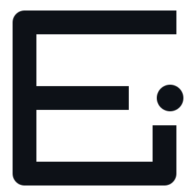
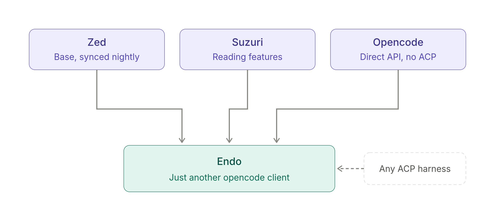

  <picture>
    <source media="(prefers-color-scheme: dark)" srcset="assets/endo-mark-dark.svg">
    <source media="(prefers-color-scheme: light)" srcset="assets/endo-mark-light.svg">
    
  </picture>

<h1 align="center">Endo</h1>

  <em>An experiment for the balanced.</em>

  <a href="#what-is-endo">What is Endo?</a> ·
  <a href="#why-endo">Why Endo</a> ·
  <a href="#the-current-idea">The current idea</a>

---

We are in a really weird place right now. On one hand, you have experienced engineers with AI psychosis saying the field is done, coding is dead, taste matters, you are a product person and you are a manager of agents. On the other hand, you have the "AI is evil, it's slop, it's just reproducing what's already there, ban the damn thing" camp.

When asked "So how do I develop taste? How do I become a good product person? How do I know what to build?", the AI psychotics answer with silence or give some vague, high-level answer like "understanding how computers work is still needed", but leave out the known axiom that **to understand is to do**. Hence, asking Opus 5.5 to do it for you only makes you better at asking Opus 5.5 to do it for you.

As for the AI doomers, well, they have valid reasons, but unfortunately this technology is truly a game changer. You can't just sit back and fold your arms out of fear. It's better to stand up and invent the future you want to see.

## What is Endo?

So what is Endo? Endo is an experiment for the balanced: the people who believe this technology is a game changer but know that to do game-changing things with it, they cannot outsource their understanding. That means exercising balance in how you learn or work.

Some days you might be fully vibe coding. Other days you're deep in the code implementing the Raft algorithm to understand how it works, asking your agent to write a test suite to make sure you're training the LLM in your head to think of edge cases, etc.

## Why Endo

Most new agentic development environments live on the extreme end. They encourage offloading your thinking to Opus; browsing the artifacts (code) and understanding the design (architecture) or solution is secondary. I'm not saying you can't do this in Claude Desktop or the Codex app. You can, but those features are second-class compared to the features that encourage spending more tokens. So for newbies and the uninitiated, it takes discipline not to let go.

Endo is an experiment in balance. It starts with a traditional IDE and sees how far we can push it toward the extreme without sacrificing the benefits the traditional IDE gave us: a place to practice, to read, to hone our craft.

- If the day calls for full vibe coding, no problem, Endo's got you.
- If it calls for digging in, sweating and pushing the LLM in your head to actually develop, Endo's got you too.

See [this post by Andrej Karpathy](https://x.com/karpathy/status/1756380066580455557).

## The current idea

> [!NOTE]
> This will evolve over time as the world changes, but for now Endo comprises three core ideas.

1. **A very friendly fork of [Zed](https://zed.dev).** Changes from upstream are synced nightly.
2. **Rebases the reading features from [Suzuri](https://suzuri.ai/)**, another fork of Zed.
3. **First-class support for [opencode](https://opencode.ai/).** It forgoes the ACP layer and talks to the opencode API directly. So, just like the opencode TUI, Endo is just another opencode client.

   Endo's aim is not to be a harness orchestrator, but since it's basically Zed, you can still use any other harness through ACP. Nevertheless, to provide the best vibe coding experience, a direct integration with a harness is sometimes needed, and there's no better option than opencode.

So basically:

  

